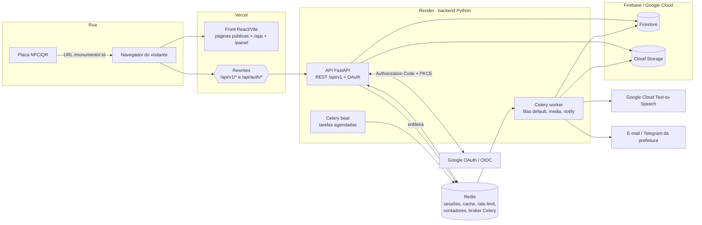
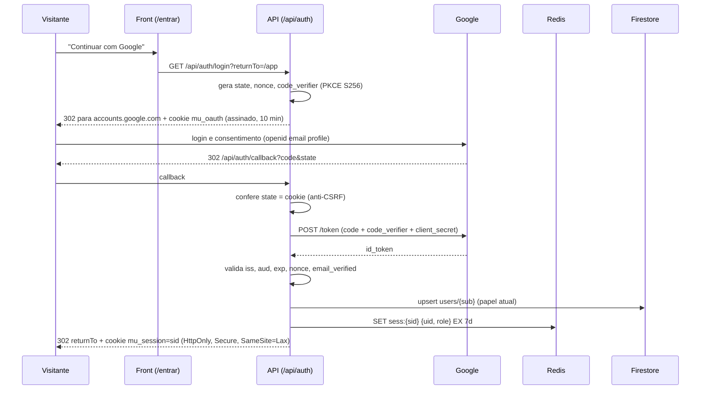

# Arquitetura · Memória Urbana Maceió

Este documento descreve a arquitetura-alvo do sistema e o caminho até ela. Cada bloco tem tasks correspondentes no Jira (projeto KAN). Os nomes dos épicos aparecem entre colchetes.

> **Regra de produto que guia tudo:** quem lê a placa vê o monumento e o convite ao museu **sem login, sem app e sem cadastro**. Conta, pontos, papéis e processamento pesado ficam atrás da página pública e nunca a deixam mais lenta.

## 1. Visão geral



| Camada | Tecnologia | Por quê |
|---|---|---|
| Front | React 19 + Vite + Tailwind, na Vercel | Página pública leve, uma URL por monumento, deploy a cada push |
| API | FastAPI (Python 3.12) + Uvicorn | Gera OpenAPI sozinha, tipagem com Pydantic, mesma linguagem do Celery |
| Tarefas assíncronas | Celery 5 | Áudio, fotos, notificações e agregações rodam fora da requisição do visitante |
| Cache, sessões e broker | Redis 7 | Um serviço para cache, sessões revogáveis, rate limit, contadores e fila do Celery |
| Banco | Firebase Firestore | Documento por monumento combina com o conteúdo; plano gratuito; regras de segurança |
| Arquivos | Firebase Cloud Storage | Fotos de relatos e MP3 das narrações |
| Identidade | Google OAuth 2.0 / OpenID Connect | O visitante já tem conta Google; só recebemos nome, e-mail e foto |
| Hospedagem do backend | Render (web service + background worker + Key Value/Redis) | Sobe API, worker e beat a partir de um `render.yaml`. Alternativa: Cloud Run |

## 2. Fases (iterativo e incremental)

| Fase | Sprint | O que fica de pé |
|---|---|---|
| 1 · já entregue | 5 | Rotas públicas só de monumentos; OAuth (Authorization Code + PKCE) em Vercel Functions com sessão em cookie assinado; front em `app/` + `features/` |
| 2 · fundação | 6 | Backend FastAPI, Docker Compose, projeto Firebase, regras do Firestore, módulo de níveis de acesso (RBAC), CI do backend |
| 3 · dados e sessões | 7 | Redis + Celery no ar; OAuth migra para a API com sessão no Redis; API de monumentos e de relatos; fotos no Storage |
| 4 · processamento | 8 | Narração TTS, notificação de relatos, agregação de visitas, painel lendo a API, gestão de papéis e auditoria |
| 5 · abertura e LGPD | 9 | API de parceiros com chave, mescla do progresso do aparelho, exclusão de dados, testes de carga e OWASP ZAP |

O contrato `/api/auth/*` é o mesmo nas fases 1 e 3. Na fase 3 só muda o destino do rewrite na Vercel; o front não muda.

## 3. Identidade: OAuth 2.0 + OpenID Connect [E11]



- **Nenhum token do Google** fica no navegador nem no banco. A API usa o `id_token` uma vez para identificar a pessoa e descarta.
- **Fase 1 (no ar):** a sessão é um cookie assinado com HMAC (`api/_lib/session.ts`). É simples, mas não pode ser revogada antes de expirar.
- **Fase 3:** a sessão passa a viver no Redis (`sess:{sid}`). Quando o papel de alguém muda ou a conta é excluída, a API apaga as sessões em `user_sessions:{uid}` e o acesso cai na hora.
- **Variáveis:**
  - `GOOGLE_CLIENT_ID` e `GOOGLE_CLIENT_SECRET` (Google Cloud Console → Credenciais → ID do cliente OAuth, tipo Web, redirect `https://memoria-urbana-maceio.vercel.app/api/auth/callback`);
  - `SESSION_SECRET` (32+ caracteres aleatórios);
  - `GESTOR_EMAILS` (só na fase 1; na fase 3 o papel vem do Firestore).

## 4. Níveis de acesso (RBAC) [E11]

Cinco papéis para pessoas, em hierarquia: anônimo ⊂ participante ⊂ {curador | gestor} ⊂ admin. Há ainda um papel de máquina para parceiros:

| Permissão | anônimo | participante | curador | gestor | admin | parceiro (chave de API) |
|---|:-:|:-:|:-:|:-:|:-:|:-:|
| `monument:read` ler monumento, ouvir, ver museu | ✓ | ✓ | ✓ | ✓ | ✓ | ✓ |
| `report:create` relatar dano (com rate limit) | ✓ | ✓ | ✓ | ✓ | ✓ | |
| `visit:create` registrar leitura anônima | ✓ | ✓ | ✓ | ✓ | ✓ | |
| `stamp:write_own` carimbos e passaporte na conta | | ✓ | ✓ | ✓ | ✓ | |
| `immersive:read` 3D e RA | | ✓ | ✓ | ✓ | ✓ | |
| `profile:delete_own` excluir conta e dados (LGPD) | | ✓ | ✓ | ✓ | ✓ | |
| `monument:write` editar bio, audiodescrição, fontes | | | ✓ | | ✓ | |
| `monument:publish` publicar (dispara áudio) | | | ✓ | | ✓ | |
| `report:read` / `report:update` triagem de relatos | | | | ✓ | ✓ | |
| `analytics:read` painel de visitas e saúde das tags | | | | ✓ | ✓ | |
| `role:assign` dar e tirar papéis | | | | | ✓ | |
| `audit:read` ler auditoria | | | | | ✓ | |
| `flow:read` dados agregados de fluxo | | | | ✓ | ✓ | ✓ |

> Curador e gestor são ramos separados: quem cuida do conteúdo não vê relatos, e quem cuida dos relatos não edita conteúdo. O admin tem tudo.

- **Onde a regra é aplicada:**
  - **Na API (fonte da verdade):** dependência `require("report:read")` em cada rota (`backend/app/core/rbac.py`).
  - **No Firestore:** as regras negam leitura e escrita direta do cliente (`firebase/firestore.rules`). Só a API, com o Admin SDK, acessa os dados.
  - **No front:** `AuthGate` só esconde telas. Não é segurança.
- **Atribuição de papel:**
  - todo login novo nasce `participante`;
  - o primeiro `admin` é definido por variável `BOOTSTRAP_ADMIN_EMAIL`;
  - depois disso, só um admin muda papéis, por `PATCH /api/v1/admin/users/{uid}/role`;
  - toda mudança grava em `audit_log` e derruba as sessões da pessoa.
- **Parceiros:** chave de API com escopo (`flow:read`). O banco guarda só o hash SHA-256 da chave, e cada parceiro tem rate limit próprio no Redis.

## 5. APIs [E8]

### 5.1 API própria (REST, `/api/v1`, documentação em `/api/v1/docs`)

| Método e rota | Permissão | O que faz |
|---|---|---|
| `GET /monuments` | `monument:read` | Lista publicada (cache Redis 10 min) |
| `GET /monuments/{id}` | `monument:read` | Monumento, museu, fontes e URLs de áudio (cache Redis) |
| `POST /visits` | `visit:create` | Leitura anônima `{monumentId, method: qr/nfc}`; só faz `INCR` no Redis |
| `POST /reports` | `report:create` | Relato anônimo; 5 por hora por IP (hash); foto vai para fila `media` |
| `GET /reports?status=` | `report:read` | Triagem do gestor |
| `PATCH /reports/{id}` | `report:update` | Muda status e registra quem tratou |
| `GET /me` | logado | Perfil e papel |
| `GET /me/stamps` / `POST /me/stamps` | `stamp:write_own` | Carimbos; check-in idempotente por dia |
| `POST /me/merge-device` | `stamp:write_own` | Mescla o progresso guardado no aparelho (ver §9) |
| `DELETE /me` | `profile:delete_own` | Exclusão da conta (task Celery apaga tudo) |
| `PUT /monuments/{id}` · `POST /monuments/{id}/publish` | `monument:write` / `monument:publish` | Curadoria; publicar invalida cache e gera áudio |
| `GET /analytics/visits` · `GET /analytics/tags` | `analytics:read` | Painel da prefeitura |
| `PATCH /admin/users/{uid}/role` · `GET /admin/audit` | `role:assign` / `audit:read` | Administração |
| `GET /partners/flow?from&to` | `flow:read` (chave) | Fluxo agregado por monumento e hora, sem dado pessoal |

Padrões das rotas:
- erros no formato RFC 9457 (`application/problem+json`);
- paginação por cursor;
- `ETag` nas leituras públicas;
- versão na URL.

### 5.2 APIs externas consumidas

| API | Para quê | Quem chama |
|---|---|---|
| Google OAuth 2.0 / OIDC | Login | API (auth) |
| Firebase Admin SDK (Firestore + Storage) | Dados e arquivos | API e worker |
| Google Cloud Text-to-Speech (voz pt-BR Neural2) | Gera os MP3 da bio e da audiodescrição ao publicar | Worker (fila `media`) |
| Google Maps URLs | Link "Como chegar" ao museu, sem chave e sem custo | Front |
| Cloud Vision SafeSearch (opcional) | Barra foto imprópria em relato | Worker (fila `media`) |
| E-mail (SMTP/SendGrid) ou Bot do Telegram | Avisar a equipe de patrimônio de relato novo | Worker (fila `notify`) |

## 6. Celery + Redis [E10]

**Filas:**
- `default`: geral;
- `media`: CPU e rede pesadas;
- `notify`: rápida, com retry.

Broker e result backend ficam no Redis (bancos 1 e 2). Toda task:
- é idempotente;
- tem `acks_late=True`, `max_retries` e backoff exponencial;
- tem `time_limit`.

| Task | Gatilho | O que faz |
|---|---|---|
| `media.generate_narration(monument_id, version)` | Publicar monumento | Chama o TTS, sobe `audio/{id}/{v}/bio.mp3` e `desc.mp3`, grava URLs e invalida o cache |
| `media.process_report_photo(report_id)` | Relato com foto | Reduz para 1280 px, **remove EXIF/GPS** (LGPD), gera miniatura e roda moderação |
| `notify.new_report(report_id)` | Relato criado | Avisa o gestor por e-mail ou Telegram |
| `default.flush_visits` | Beat, a cada 15 min | Lê `visits:*` e `hll:*` do Redis e grava `visits_daily` no Firestore |
| `default.check_tag_health` | Beat, diário 06:00 | Placa sem leitura há 7 dias → status "verificar" e aviso ao gestor |
| `default.delete_user_data(uid)` | `DELETE /me` | Apaga carimbos, sessões e perfil; grava auditoria |
| `default.purge_expired` | Beat, diário 03:00 | Retenção LGPD: relatos > 12 meses anonimizados, hashes de IP rotacionados |
| `default.merge_device_progress(uid, payload)` | `POST /me/merge-device` | Valida tokens de carimbo e grava na conta |

**Chaves no Redis (DB 0):**

| Chave | Tipo | TTL | Uso |
|---|---|---|---|
| `sess:{sid}` | hash | 7 dias | Sessão (uid, papel, criada em) |
| `user_sessions:{uid}` | set | 7 dias | Revogar todas as sessões da pessoa |
| `cache:monuments`, `cache:monument:{id}` | string JSON | 10 min | Leitura pública |
| `rl:report:{iphash}:{AAAAMMDDHH}` | contador | 1 h | Rate limit de relatos (5/h) |
| `rl:partner:{keyid}:{minuto}` | contador | 1 min | Rate limit de parceiros |
| `visits:{AAAAMMDD}:{monumento}` | contador | 2 dias | Leituras por dia |
| `hll:visitors:{AAAAMMDD}:{monumento}` | HyperLogLog | 2 dias | Visitantes únicos aproximados, sem guardar identidade |
| `idem:stamp:{uid}:{monumento}:{AAAAMMDD}` | string (SET NX) | 1 dia | Check-in idempotente |

## 7. Banco no Firebase [E9]

**Firestore (modo nativo, região `southamerica-east1`):**

```
monuments/{id}            name, role, years, summary, audioDescription, plate, geo, kind,
                          museum{name,address,hours,why}, facts[], sources[{label,url}],
                          status: draft|published, audio{bioUrl, descUrl, version},
                          updatedAt, updatedBy
users/{uid}               name, email, picture, role, consent{history,location,at},
                          createdAt, lastLoginAt, deviceMergedAt
users/{uid}/stamps/{mid}  at, method: qr|nfc|gps, source: online|device_merge
reports/{id}              monumentId, kind, note, photoPath, status, createdAt,
                          ipHash, handledBy, handledAt
visits_daily/{AAAAMMDD_mid}  reads, uniqueApprox, museumClicks
tags/{plate}              type, status, lastReadAt
audit_log/{id}            actor, action, target, before, after, at
api_partners/{id}         name, keyHash, scopes[], ratePerMin, active
```

- **Storage:**
  - `reports/{id}/foto.jpg` e `thumb.jpg`, privados, servidos por URL assinada de 15 min;
  - `audio/{id}/{v}/bio.mp3` e `desc.mp3`, públicos, com cache longo.
- **Regras:** `firebase/firestore.rules` e `storage.rules` negam acesso direto de cliente. A exceção é a leitura de `audio/**`.
- **Índices:**
  - `reports` (status, createdAt desc);
  - `visits_daily` (mid, data).
- **Desenvolvimento:** Firebase Emulator Suite no Docker Compose. Os testes nunca tocam o projeto real.

## 8. Segurança (OWASP Top 10)

| Risco | Medida |
|---|---|
| A01 Controle de acesso | RBAC na API, regras do Firestore negando cliente, testes de autorização por rota |
| A02 Falhas criptográficas | Cookies `HttpOnly; Secure; SameSite=Lax`, HSTS, sessões no Redis, segredos só em variáveis de ambiente |
| A03 Injeção | Pydantic valida tudo; nada de query montada com string; React escapa a saída |
| A04 Design inseguro | Página pública sem conta; minimização de dados; rate limit em relatos |
| A05 Configuração | Cabeçalhos de segurança na Vercel, CORS fechado no domínio, docs da API só fora de produção |
| A06 Componentes vulneráveis | `pnpm audit` e `pip-audit` no CI, Dependabot |
| A07 Autenticação | OAuth com PKCE, state e nonce; logout por POST; revogação de sessão |
| A08 Integridade | Deploy só pela `main` protegida; CI verde obrigatório |
| A09 Logs | `audit_log` para papéis e relatos; logs sem dado pessoal |
| A10 SSRF | Worker só chama domínios de uma lista (Google, provedor de e-mail) |

## 9. Gamificação sem login (em estudo)

A ideia é guardar carimbos no próprio aparelho, sem conta, e levá-los para a conta se a pessoa entrar depois. Uma task de estudo no Jira compara as opções e responde às perguntas abaixo antes de qualquer código:

- **Onde guardar:** `localStorage`, IndexedDB ou Cache API/Service Worker. Também é preciso ver como funciona `navigator.storage.persist()`.
- **Riscos:**
  - limpeza automática do Safari (ITP, 7 dias sem visita);
  - aba anônima;
  - troca de aparelho.
- **Fraude:** como impedir carimbo "de sofá". A proposta é a placa trazer um token por placa, e o servidor devolver um token de carimbo assinado (HMAC) que só ele valida na mescla.
- **LGPD:** usar ID aleatório do aparelho, nunca fingerprint.

## 10. Estrutura do repositório

```
src/                    front (React)
  app/                  roteador e rotas
  features/monument/    páginas públicas: índice, monumento, 404, relatos
  features/auth/        /entrar, AuthGate, useSession
  features/trail/       área com conta (/app)
  features/panel/       painel da prefeitura (/painel)
  *.tsx (raiz)          protótipo do Figma Make, servido em /prototipo
api/                    fase 1 do login: Vercel Functions (sai na fase 3)
backend/                fase 2+: FastAPI, Celery, RBAC (esqueleto)
firebase/               regras do Firestore e do Storage, índices
infra/                  docker-compose.yml para desenvolvimento
docs/                   esta arquitetura
tests/                  testes do front e da fase 1 do login
```
