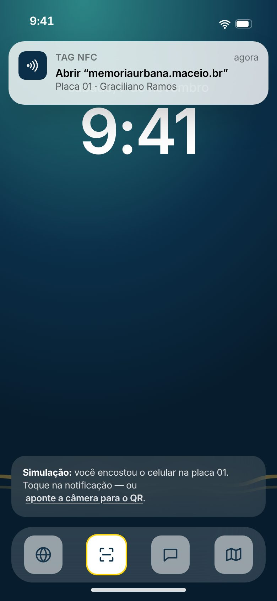
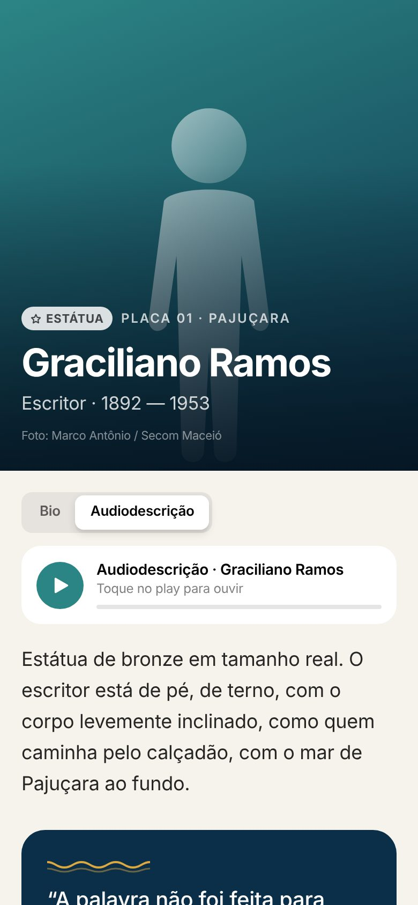
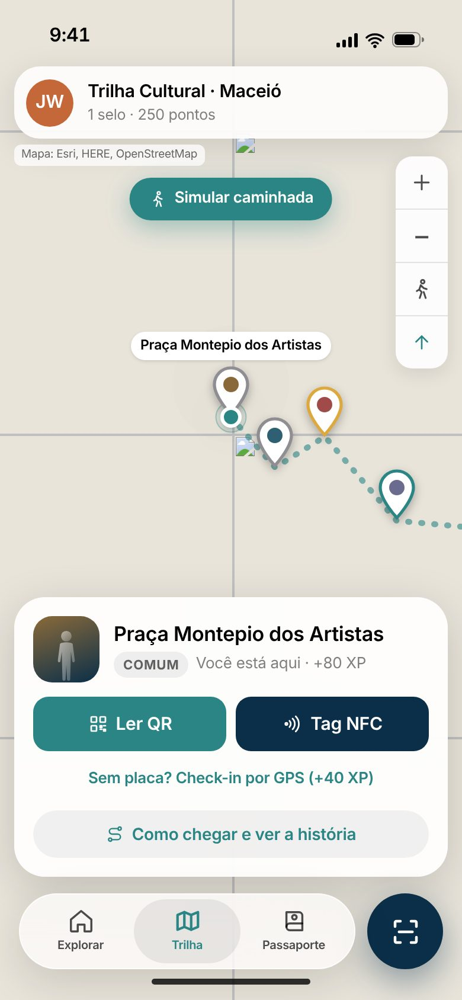
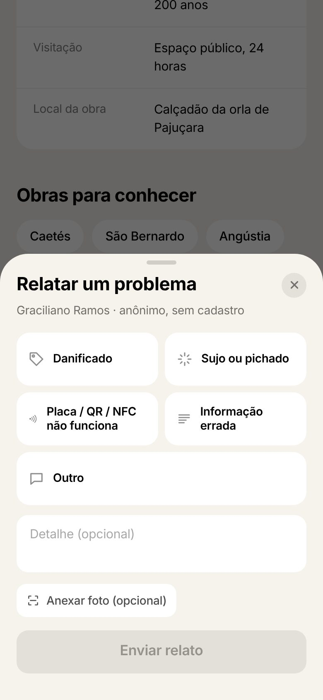
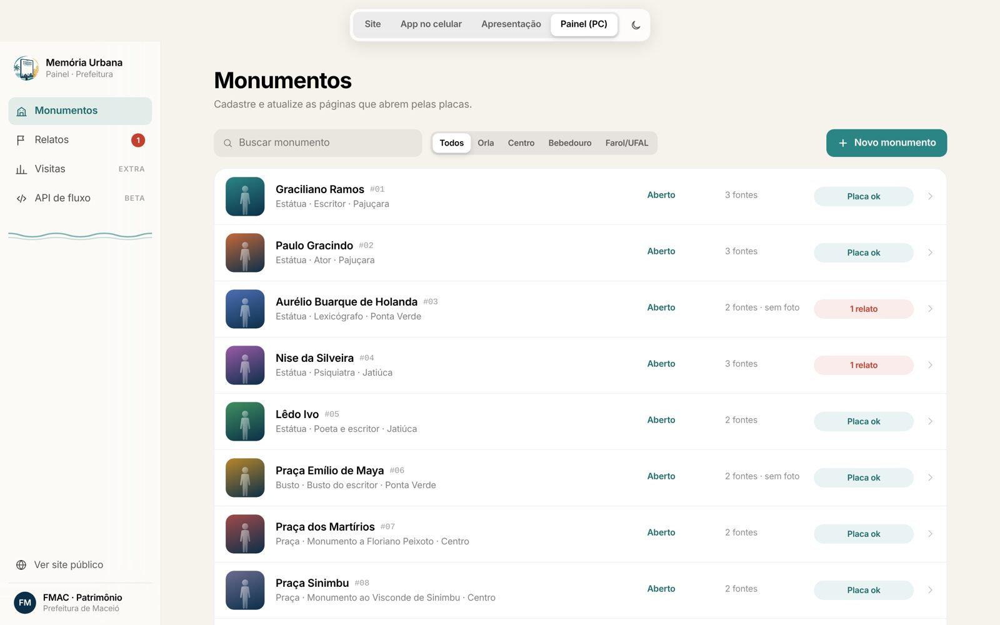
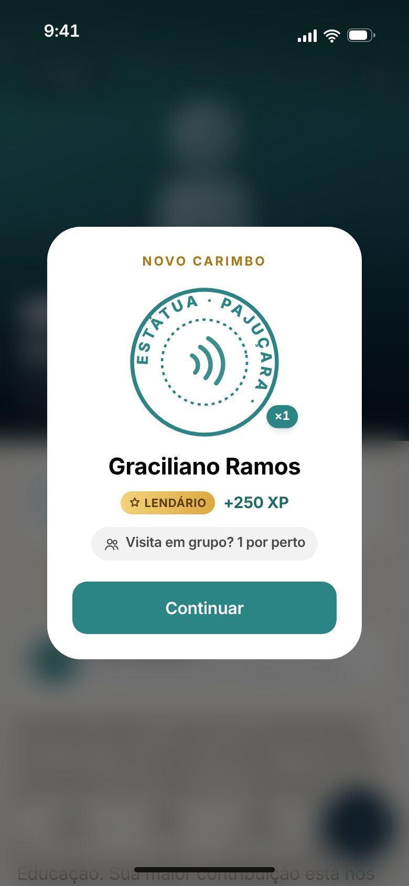
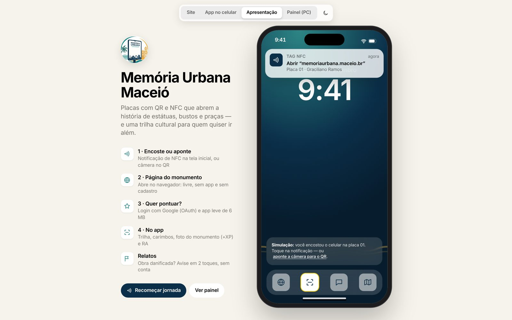
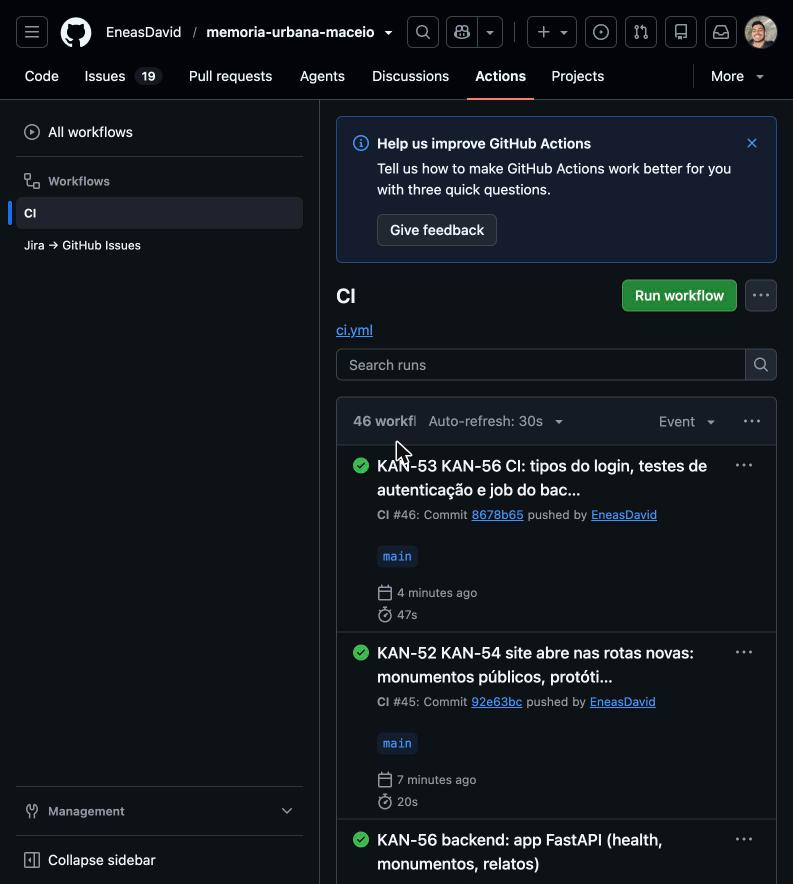
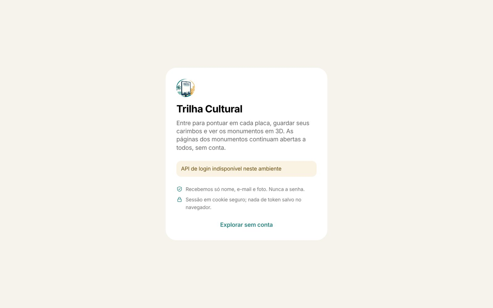
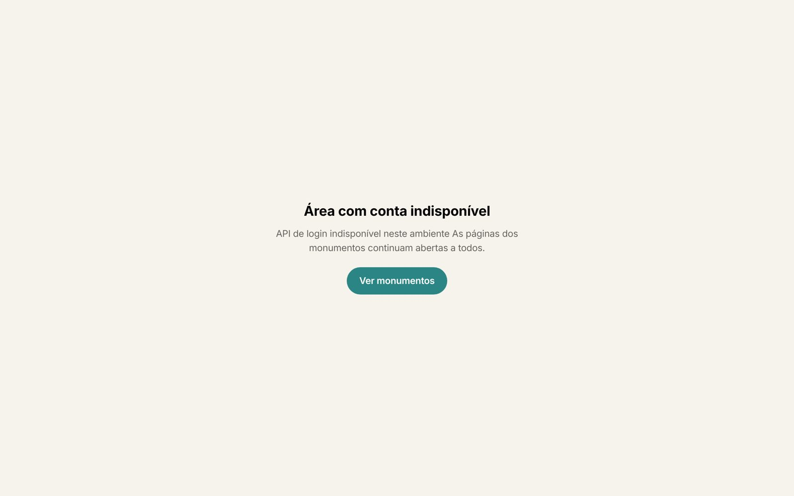

# Evidências das tasks concluídas

Prints usados nos comentários de "como foi feito" das tasks do Jira (projeto KAN). Cada task concluída tem um comentário com a descrição e o print anexado.

| Task | O que mostra | Print |
|---|---|---|
| [KAN-10](https://ic-team-yrsngn10.atlassian.net/browse/KAN-10) | Ler a placa por NFC |  |
| [KAN-11](https://ic-team-yrsngn10.atlassian.net/browse/KAN-11) | Ler a placa por QR Code |  |
| [KAN-12](https://ic-team-yrsngn10.atlassian.net/browse/KAN-12) | Página aberta do monumento |  |
| [KAN-13](https://ic-team-yrsngn10.atlassian.net/browse/KAN-13) | Bio do homenageado em linguagem simples |  |
| [KAN-14](https://ic-team-yrsngn10.atlassian.net/browse/KAN-14) | Card "Como chegar" ao museu |  |
| [KAN-15](https://ic-team-yrsngn10.atlassian.net/browse/KAN-15) | Abas Bio e Audiodescrição |  |
| [KAN-19](https://ic-team-yrsngn10.atlassian.net/browse/KAN-19) | Rota de ônibus ou a pé |  |
| [KAN-20](https://ic-team-yrsngn10.atlassian.net/browse/KAN-20) | Mapa da Trilha Cultural |  |
| [KAN-21](https://ic-team-yrsngn10.atlassian.net/browse/KAN-21) | Carimbos e passaporte |  |
| [KAN-22](https://ic-team-yrsngn10.atlassian.net/browse/KAN-22) | Login com Google opcional |  |
| [KAN-24](https://ic-team-yrsngn10.atlassian.net/browse/KAN-24) | Relato de dano em 2 toques |  |
| [KAN-25](https://ic-team-yrsngn10.atlassian.net/browse/KAN-25) | Painel da prefeitura |  |
| [KAN-27](https://ic-team-yrsngn10.atlassian.net/browse/KAN-27) | Corrigir: QR escondido na Trilha |  |
| [KAN-28](https://ic-team-yrsngn10.atlassian.net/browse/KAN-28) | Corrigir: câmera travava sem leitor de QR |  |
| [KAN-29](https://ic-team-yrsngn10.atlassian.net/browse/KAN-29) | Corrigir: ficha da Trilha sobre a história |  |
| [KAN-30](https://ic-team-yrsngn10.atlassian.net/browse/KAN-30) | Corrigir: ficha do Passaporte sem fechar |  |
| [KAN-31](https://ic-team-yrsngn10.atlassian.net/browse/KAN-31) | Corrigir: ficha do Passaporte presa na lista |  |
| [KAN-34](https://ic-team-yrsngn10.atlassian.net/browse/KAN-34) | Teste de usabilidade com moradores |  |
| [KAN-39](https://ic-team-yrsngn10.atlassian.net/browse/KAN-39) | Protótipo navegável no Figma Make |  |
| [KAN-40](https://ic-team-yrsngn10.atlassian.net/browse/KAN-40) | Repositório GitHub público com o código do Make |  |
| [KAN-41](https://ic-team-yrsngn10.atlassian.net/browse/KAN-41) | Pipeline de CI no GitHub Actions |  |
| [KAN-42](https://ic-team-yrsngn10.atlassian.net/browse/KAN-42) | Testes de dados e de integração (smoke) |  |
| [KAN-43](https://ic-team-yrsngn10.atlassian.net/browse/KAN-43) | Deploy contínuo na Vercel |  |
| [KAN-44](https://ic-team-yrsngn10.atlassian.net/browse/KAN-44) | Sincronizar backlog do Jira com Issues do GitHub |  |
| [KAN-45](https://ic-team-yrsngn10.atlassian.net/browse/KAN-45) | Corrigir: novo monumento no painel sem campo museum |  |
| [KAN-52](https://ic-team-yrsngn10.atlassian.net/browse/KAN-52) | Rotas públicas só de monumentos |  |
| [KAN-53](https://ic-team-yrsngn10.atlassian.net/browse/KAN-53) | OAuth fase 1: Authorization Code + PKCE |  |
| [KAN-54](https://ic-team-yrsngn10.atlassian.net/browse/KAN-54) | Estruturar o front em app/ e features/ |  |
| [KAN-55](https://ic-team-yrsngn10.atlassian.net/browse/KAN-55) | Documento de arquitetura |  |
| [KAN-56](https://ic-team-yrsngn10.atlassian.net/browse/KAN-56) | Esqueleto do backend FastAPI + Celery com RBAC |  |
