# Evidências das tasks concluídas

Prints usados nos comentários de "como foi feito" das tasks do Jira (projeto KAN). Cada task concluída tem um comentário com a descrição e o print anexado.

| Task | O que mostra | Print |
|---|---|---|
| [KAN-10](https://ic-team-yrsngn10.atlassian.net/browse/KAN-10) | Ler a placa por NFC |  |
| [KAN-11](https://ic-team-yrsngn10.atlassian.net/browse/KAN-11) | Ler a placa por QR Code | 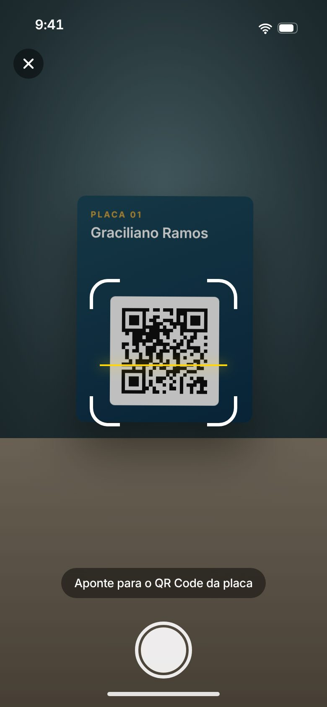 |
| [KAN-12](https://ic-team-yrsngn10.atlassian.net/browse/KAN-12) | Página aberta do monumento |  |
| [KAN-13](https://ic-team-yrsngn10.atlassian.net/browse/KAN-13) | Bio do homenageado em linguagem simples |  |
| [KAN-14](https://ic-team-yrsngn10.atlassian.net/browse/KAN-14) | Card "Como chegar" ao museu | 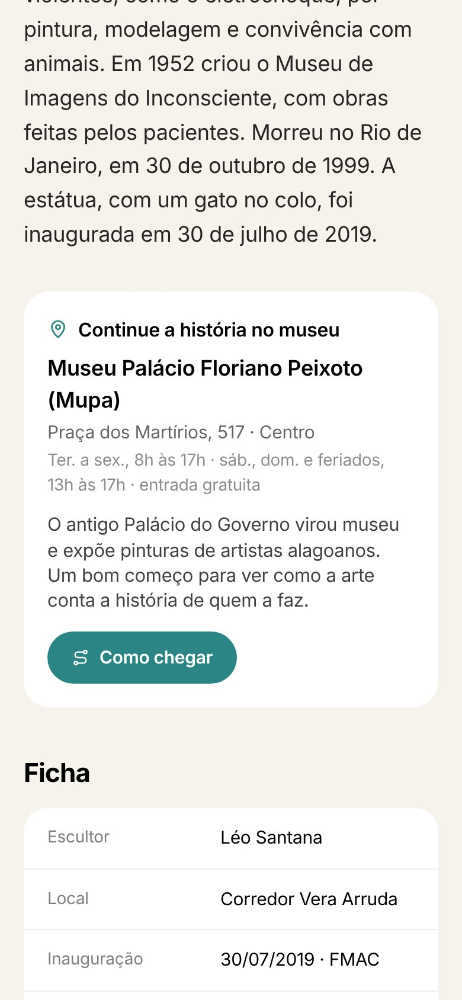 |
| [KAN-15](https://ic-team-yrsngn10.atlassian.net/browse/KAN-15) | Abas Bio e Audiodescrição |  |
| [KAN-19](https://ic-team-yrsngn10.atlassian.net/browse/KAN-19) | Rota de ônibus ou a pé | 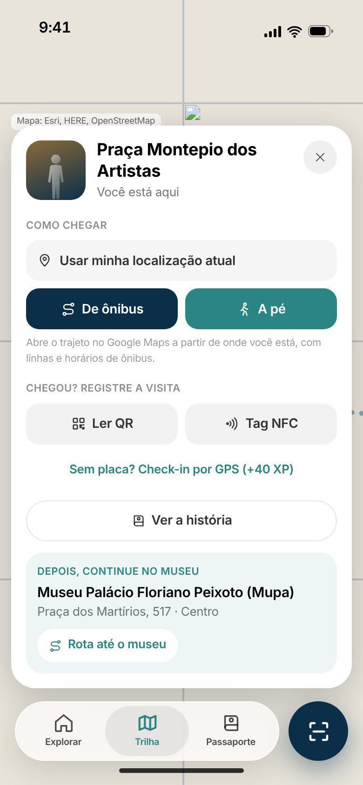 |
| [KAN-20](https://ic-team-yrsngn10.atlassian.net/browse/KAN-20) | Mapa da Trilha Cultural |  |
| [KAN-21](https://ic-team-yrsngn10.atlassian.net/browse/KAN-21) | Carimbos e passaporte | 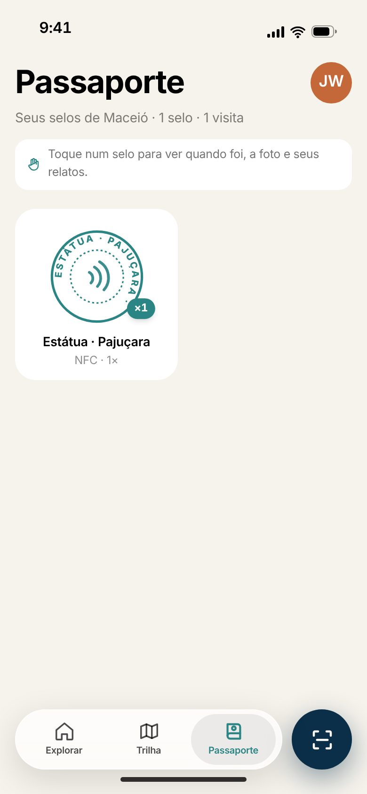 |
| [KAN-22](https://ic-team-yrsngn10.atlassian.net/browse/KAN-22) | Login com Google opcional | 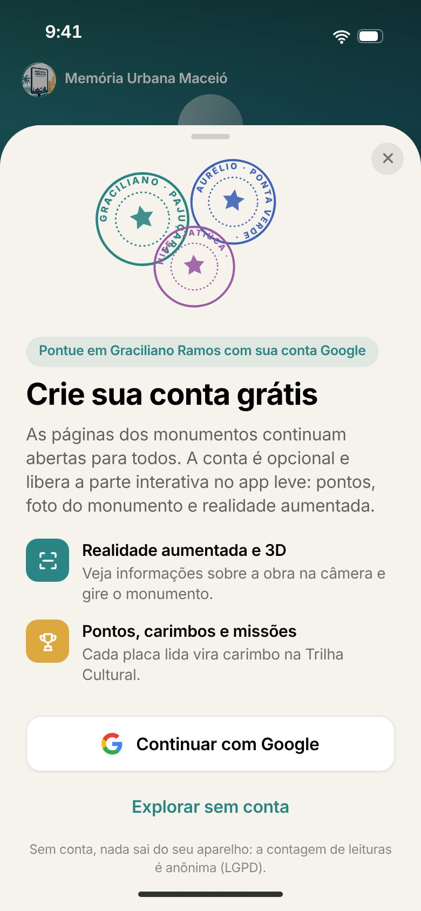 |
| [KAN-24](https://ic-team-yrsngn10.atlassian.net/browse/KAN-24) | Relato de dano em 2 toques |  |
| [KAN-25](https://ic-team-yrsngn10.atlassian.net/browse/KAN-25) | Painel da prefeitura |  |
| [KAN-27](https://ic-team-yrsngn10.atlassian.net/browse/KAN-27) | Corrigir: QR escondido na Trilha |  |
| [KAN-28](https://ic-team-yrsngn10.atlassian.net/browse/KAN-28) | Corrigir: câmera travava sem leitor de QR |  |
| [KAN-29](https://ic-team-yrsngn10.atlassian.net/browse/KAN-29) | Corrigir: ficha da Trilha sobre a história |  |
| [KAN-30](https://ic-team-yrsngn10.atlassian.net/browse/KAN-30) | Corrigir: ficha do Passaporte sem fechar | 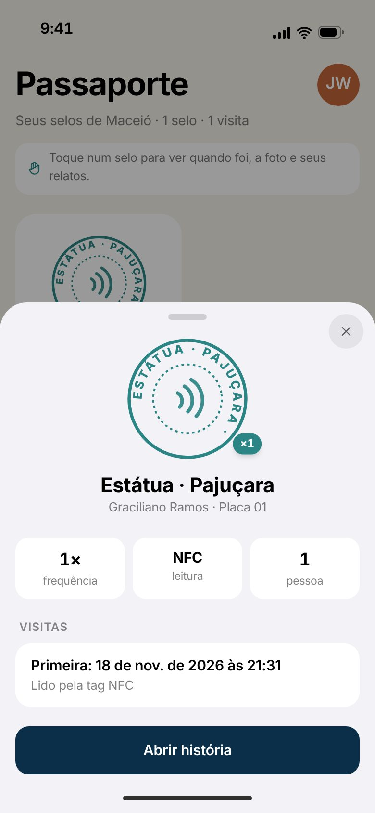 |
| [KAN-31](https://ic-team-yrsngn10.atlassian.net/browse/KAN-31) | Corrigir: ficha do Passaporte presa na lista |  |
| [KAN-34](https://ic-team-yrsngn10.atlassian.net/browse/KAN-34) | Teste de usabilidade com moradores |  |
| [KAN-39](https://ic-team-yrsngn10.atlassian.net/browse/KAN-39) | Protótipo navegável no Figma Make |  |
| [KAN-40](https://ic-team-yrsngn10.atlassian.net/browse/KAN-40) | Repositório GitHub público com o código do Make | 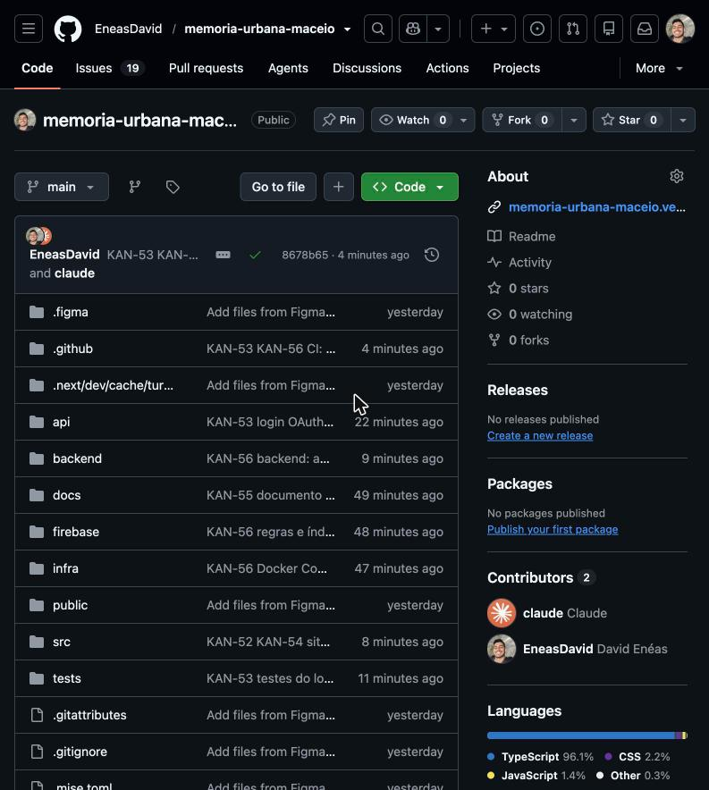 |
| [KAN-41](https://ic-team-yrsngn10.atlassian.net/browse/KAN-41) | Pipeline de CI no GitHub Actions |  |
| [KAN-42](https://ic-team-yrsngn10.atlassian.net/browse/KAN-42) | Testes de dados e de integração (smoke) |  |
| [KAN-43](https://ic-team-yrsngn10.atlassian.net/browse/KAN-43) | Deploy contínuo na Vercel | 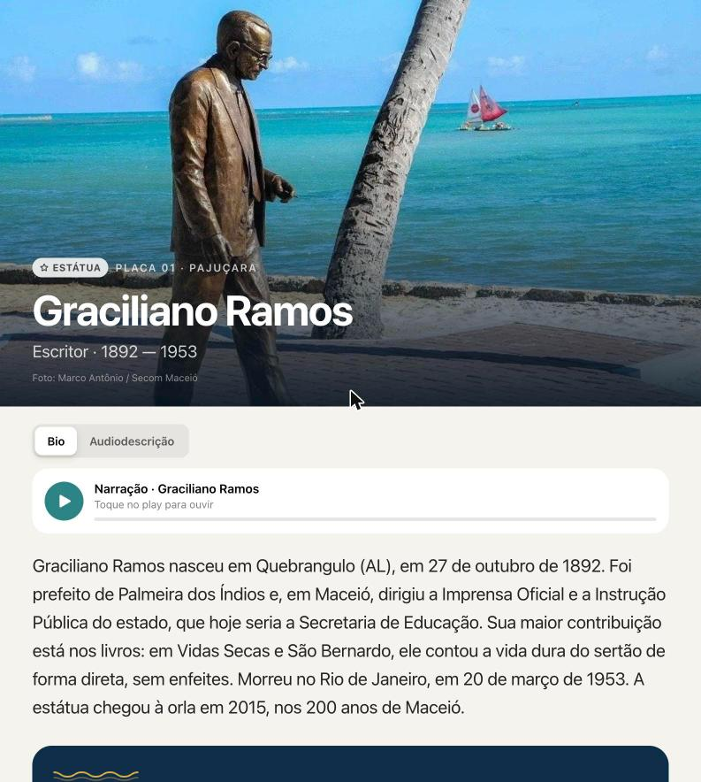 |
| [KAN-44](https://ic-team-yrsngn10.atlassian.net/browse/KAN-44) | Sincronizar backlog do Jira com Issues do GitHub | 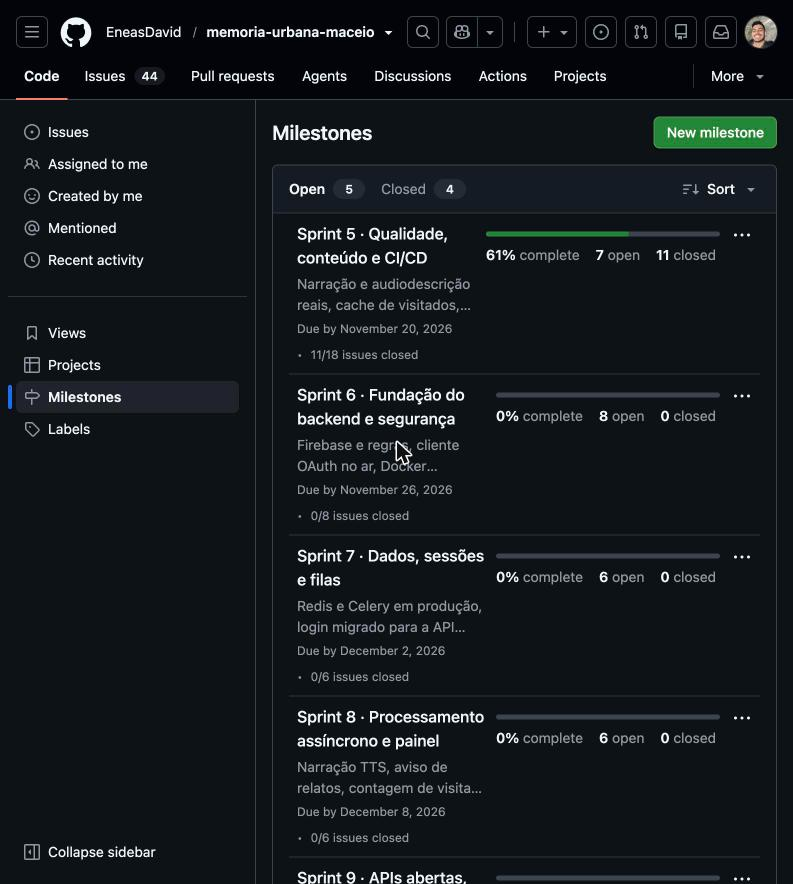 |
| [KAN-45](https://ic-team-yrsngn10.atlassian.net/browse/KAN-45) | Corrigir: novo monumento no painel sem campo museum |  |
| [KAN-52](https://ic-team-yrsngn10.atlassian.net/browse/KAN-52) | Rotas públicas só de monumentos |  |
| [KAN-53](https://ic-team-yrsngn10.atlassian.net/browse/KAN-53) | OAuth fase 1: Authorization Code + PKCE |  |
| [KAN-54](https://ic-team-yrsngn10.atlassian.net/browse/KAN-54) | Estruturar o front em app/ e features/ |  |
| [KAN-55](https://ic-team-yrsngn10.atlassian.net/browse/KAN-55) | Documento de arquitetura | 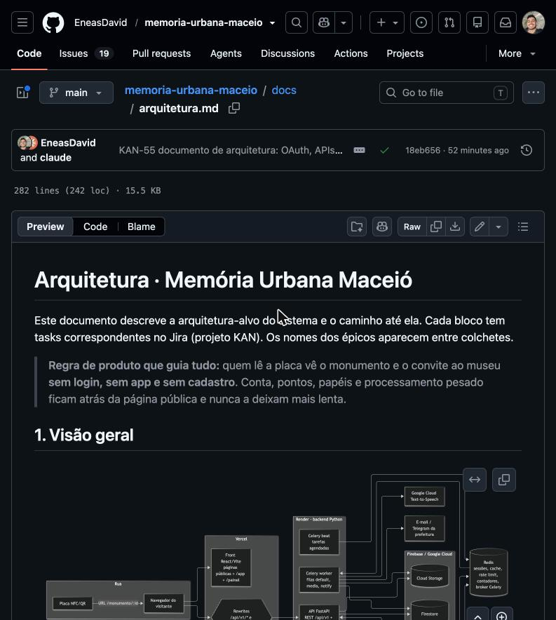 |
| [KAN-56](https://ic-team-yrsngn10.atlassian.net/browse/KAN-56) | Esqueleto do backend FastAPI + Celery com RBAC | 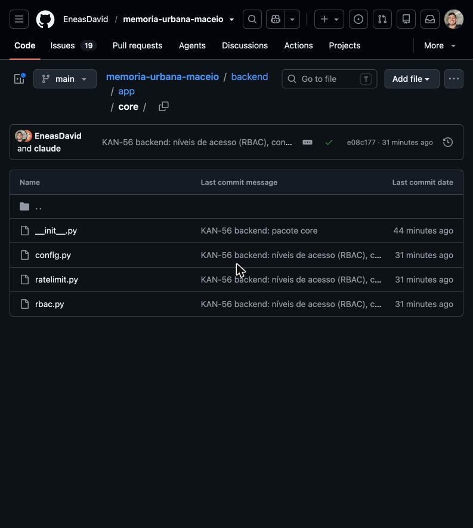 |
| [KAN-78](https://ic-team-yrsngn10.atlassian.net/browse/KAN-78) | Site segue o modo claro/escuro do aparelho | 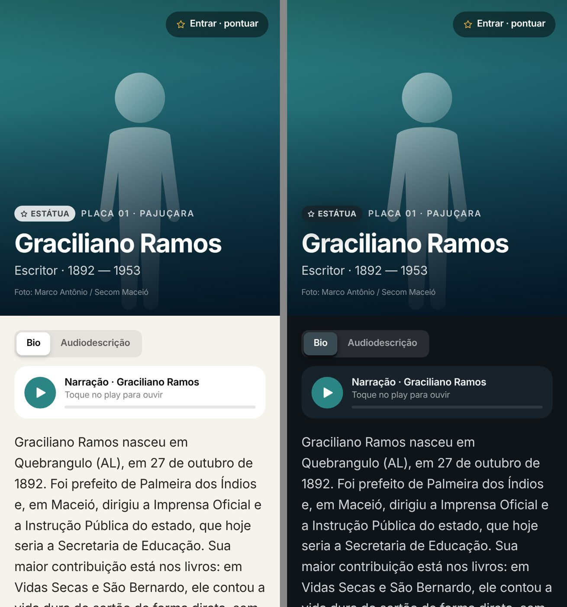 |
| [KAN-79](https://ic-team-yrsngn10.atlassian.net/browse/KAN-79) | Convite para entrar na Trilha | 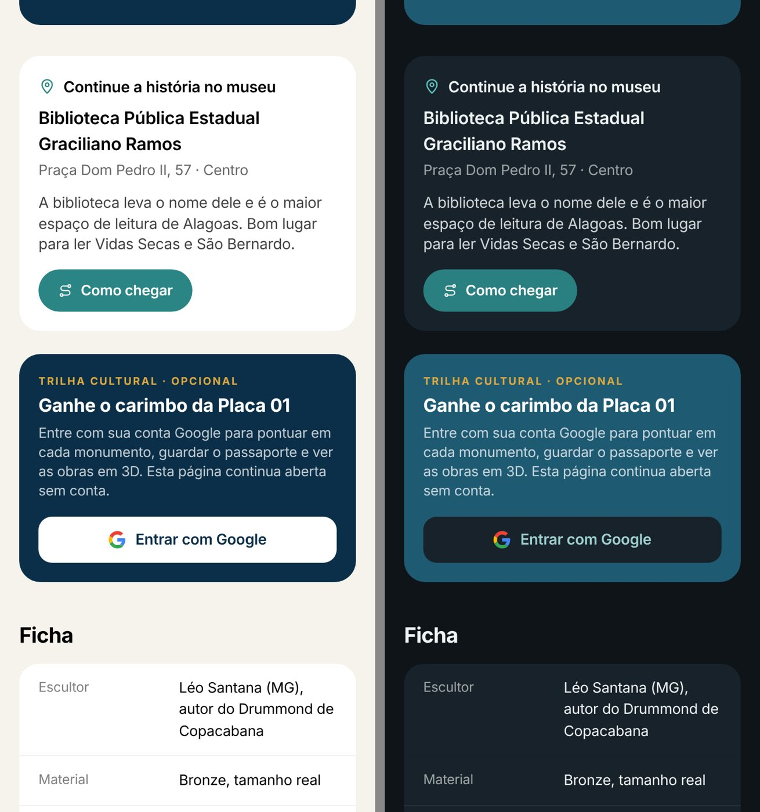 |
| [KAN-80](https://ic-team-yrsngn10.atlassian.net/browse/KAN-80) | Narração sincronizada | 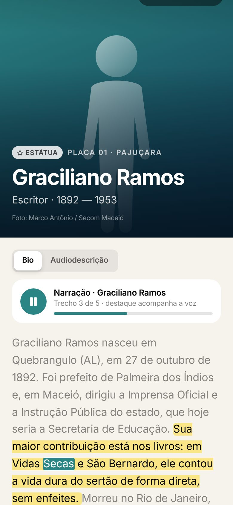 |
| [KAN-83](https://ic-team-yrsngn10.atlassian.net/browse/KAN-83) | Conformidade 1/17: Política de privacidade |  |
| [KAN-84](https://ic-team-yrsngn10.atlassian.net/browse/KAN-84) | Conformidade 2/17: Termos de serviço | 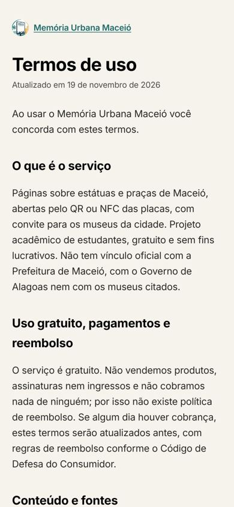 |
| [KAN-85](https://ic-team-yrsngn10.atlassian.net/browse/KAN-85) | Conformidade 3/17: Aviso de cookies |  |
| [KAN-86](https://ic-team-yrsngn10.atlassian.net/browse/KAN-86) | Conformidade 4/17: Política de reembolso |  |
| [KAN-87](https://ic-team-yrsngn10.atlassian.net/browse/KAN-87) | Conformidade 5/17: Formulários na LGPD |  |
| [KAN-88](https://ic-team-yrsngn10.atlassian.net/browse/KAN-88) | Conformidade 6/17: Só dados necessários |  |
| [KAN-89](https://ic-team-yrsngn10.atlassian.net/browse/KAN-89) | Conformidade 7/17: Scripts de tracking | 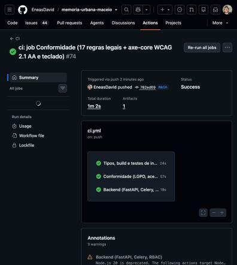 |
| [KAN-90](https://ic-team-yrsngn10.atlassian.net/browse/KAN-90) | Conformidade 8/17: Acessibilidade | 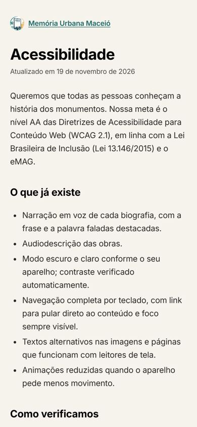 |
| [KAN-91](https://ic-team-yrsngn10.atlassian.net/browse/KAN-91) | Conformidade 9/17: Alt nas imagens | 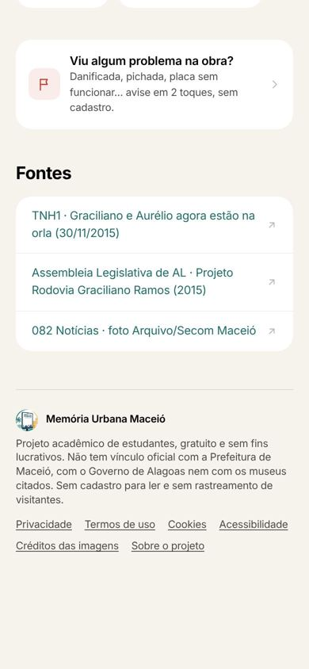 |
| [KAN-92](https://ic-team-yrsngn10.atlassian.net/browse/KAN-92) | Conformidade 10/17: Contraste corrigido |  |
| [KAN-93](https://ic-team-yrsngn10.atlassian.net/browse/KAN-93) | Conformidade 11/17: Navegação por teclado |  |
| [KAN-94](https://ic-team-yrsngn10.atlassian.net/browse/KAN-94) | Conformidade 12/17: Sem avaliações falsas | 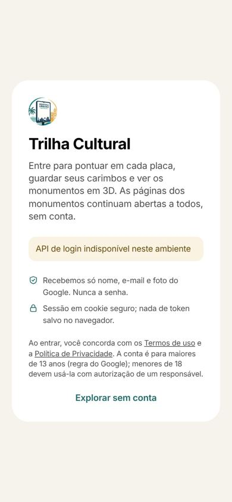 |
| [KAN-95](https://ic-team-yrsngn10.atlassian.net/browse/KAN-95) | Conformidade 13/17: Sem promessas falsas |  |
| [KAN-96](https://ic-team-yrsngn10.atlassian.net/browse/KAN-96) | Conformidade 14/17: Copyright das imagens | 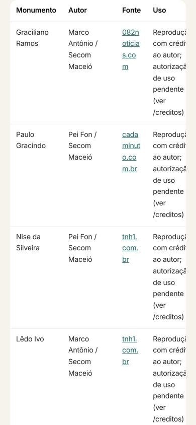 |
| [KAN-97](https://ic-team-yrsngn10.atlassian.net/browse/KAN-97) | Conformidade 15/17: Dados da empresa | 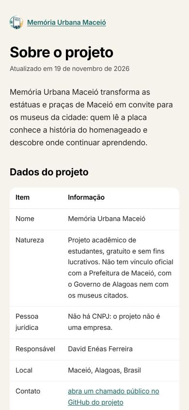 |
| [KAN-98](https://ic-team-yrsngn10.atlassian.net/browse/KAN-98) | Conformidade 16/17: Conformidade LGPD |  |
| [KAN-99](https://ic-team-yrsngn10.atlassian.net/browse/KAN-99) | Conformidade 17/17: Riscos jurídicos |  |
| [KAN-100](https://ic-team-yrsngn10.atlassian.net/browse/KAN-100) | CI: job Conformidade (LGPD, acessibilidade, legal) |  |
| [KAN-114](https://ic-team-yrsngn10.atlassian.net/browse/KAN-114) | UX 1/20: Squash & stretch | 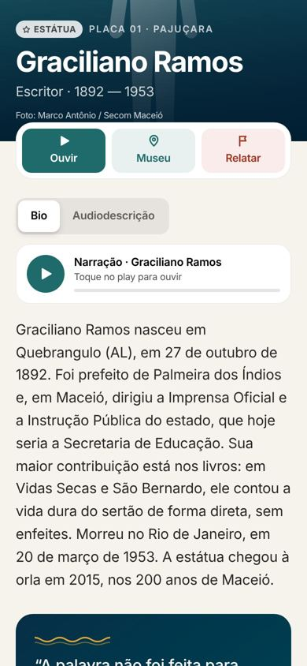 |
| [KAN-115](https://ic-team-yrsngn10.atlassian.net/browse/KAN-115) | UX 2/20: Antecipação (wind-up) | 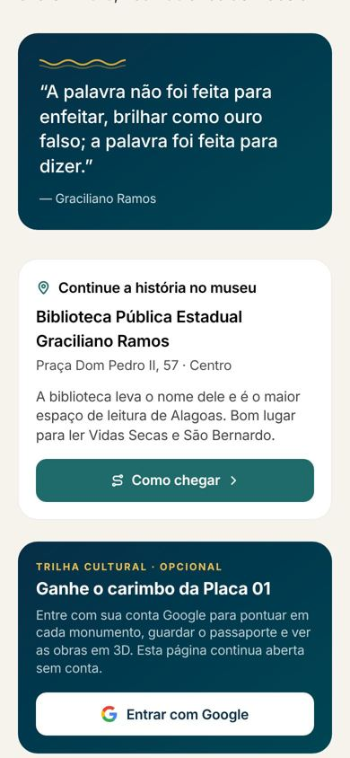 |
| [KAN-116](https://ic-team-yrsngn10.atlassian.net/browse/KAN-116) | UX 3/20: Encenar o foco (staging) | 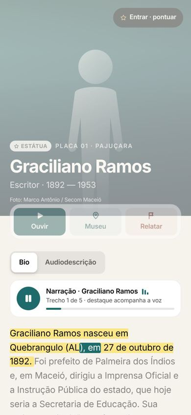 |
| [KAN-117](https://ic-team-yrsngn10.atlassian.net/browse/KAN-117) | UX 4/20: Pose a pose | 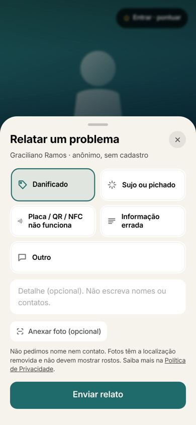 |
| [KAN-118](https://ic-team-yrsngn10.atlassian.net/browse/KAN-118) | UX 5/20: Follow through |  |
| [KAN-120](https://ic-team-yrsngn10.atlassian.net/browse/KAN-120) | UX 7/20: Movimento em arcos |  |
| [KAN-121](https://ic-team-yrsngn10.atlassian.net/browse/KAN-121) | UX 8/20: Ação secundária |  |
| [KAN-123](https://ic-team-yrsngn10.atlassian.net/browse/KAN-123) | UX 10/20: Feedback exagerado | 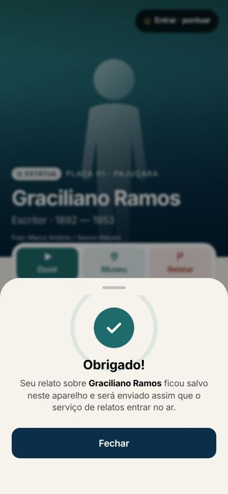 |
| [KAN-124](https://ic-team-yrsngn10.atlassian.net/browse/KAN-124) | UX 11/20: Desenho sólido em 3D | 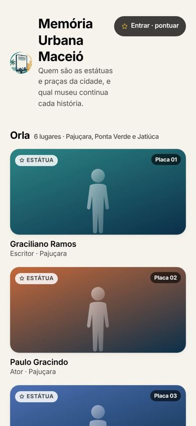 |
| [KAN-125](https://ic-team-yrsngn10.atlassian.net/browse/KAN-125) | UX 12/20: Apelo geral |  |
| [KAN-126](https://ic-team-yrsngn10.atlassian.net/browse/KAN-126) | UX 13/20: Lei de Fitts |  |
| [KAN-127](https://ic-team-yrsngn10.atlassian.net/browse/KAN-127) | UX 14/20: Áreas de toque maiores |  |
| [KAN-128](https://ic-team-yrsngn10.atlassian.net/browse/KAN-128) | UX 15/20: Lei de Hick |  |
| [KAN-129](https://ic-team-yrsngn10.atlassian.net/browse/KAN-129) | UX 16/20: Lei de Miller |  |
| [KAN-131](https://ic-team-yrsngn10.atlassian.net/browse/KAN-131) | UX 18/20: Lei de Postel | 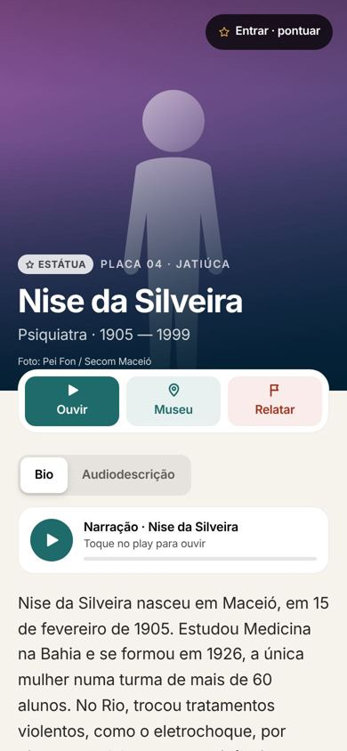 |
| [KAN-132](https://ic-team-yrsngn10.atlassian.net/browse/KAN-132) | UX 19/20: Lei de Jakob |  |
| [KAN-133](https://ic-team-yrsngn10.atlassian.net/browse/KAN-133) | UX 20/20: Frequência de uso |  |
| [KAN-134](https://ic-team-yrsngn10.atlassian.net/browse/KAN-134) | Design 1/10: Raio concêntrico |  |
| [KAN-135](https://ic-team-yrsngn10.atlassian.net/browse/KAN-135) | Design 2/10: Borda com transparência |  |
| [KAN-136](https://ic-team-yrsngn10.atlassian.net/browse/KAN-136) | Design 3/10: Paletas em OKLCH |  |
| [KAN-137](https://ic-team-yrsngn10.atlassian.net/browse/KAN-137) | Design 4/10: Degradês em OKLCH |  |
| [KAN-138](https://ic-team-yrsngn10.atlassian.net/browse/KAN-138) | Design 5/10: Ícone no peso do texto |  |
| [KAN-141](https://ic-team-yrsngn10.atlassian.net/browse/KAN-141) | Design 8/10: Profundidade no escuro |  |
| [KAN-142](https://ic-team-yrsngn10.atlassian.net/browse/KAN-142) | Design 9/10: Altura dinâmica |  |
| [KAN-143](https://ic-team-yrsngn10.atlassian.net/browse/KAN-143) | Design 10/10: Mistura multiply |  |
| [KAN-145](https://ic-team-yrsngn10.atlassian.net/browse/KAN-145) | Relato com foto ou vídeo real | 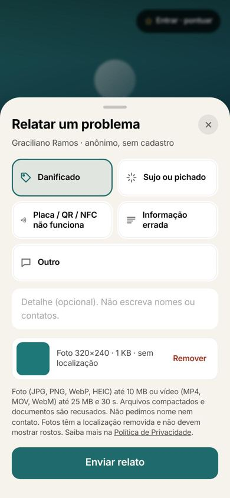 |
| [KAN-146](https://ic-team-yrsngn10.atlassian.net/browse/KAN-146) | Segurança de anexos | 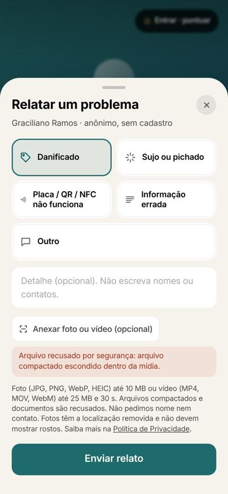 |
| [KAN-151](https://ic-team-yrsngn10.atlassian.net/browse/KAN-151) | Ferramenta 1/5 · Bom gosto | 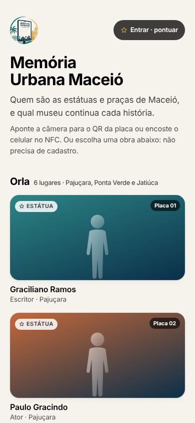 |
| [KAN-154](https://ic-team-yrsngn10.atlassian.net/browse/KAN-154) | Ferramenta 4/5 · Imagem → código | 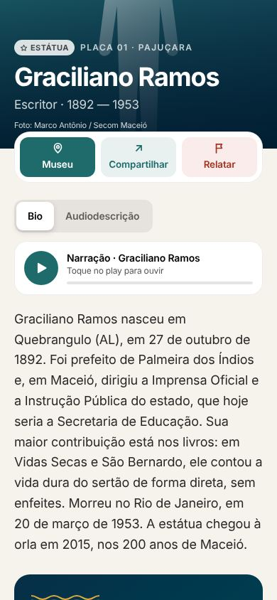 |
| [KAN-156](https://ic-team-yrsngn10.atlassian.net/browse/KAN-156) | Corrigir: dois plays |  |
| [KAN-157](https://ic-team-yrsngn10.atlassian.net/browse/KAN-157) | Corrigir: home |  |
| [KAN-163](https://ic-team-yrsngn10.atlassian.net/browse/KAN-163) | Aviso antes de câmera e galeria | 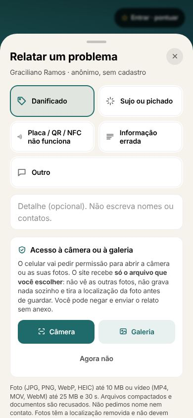 |
| [KAN-164](https://ic-team-yrsngn10.atlassian.net/browse/KAN-164) | Acesso de demonstração (login) | 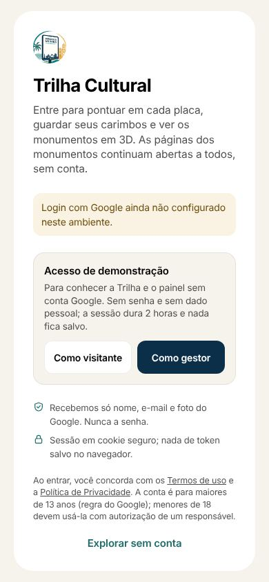 |
| [KAN-164](https://ic-team-yrsngn10.atlassian.net/browse/KAN-164) | Acesso de demonstração (painel) | 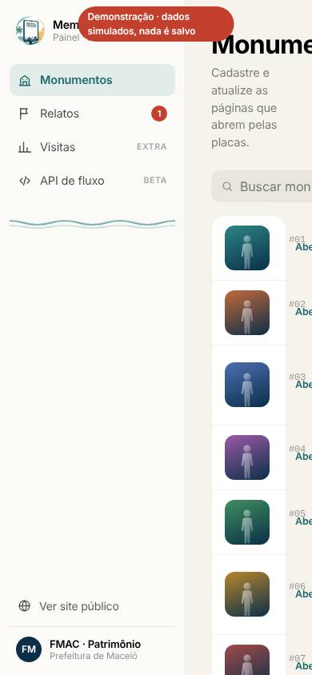 |
| [KAN-169](https://ic-team-yrsngn10.atlassian.net/browse/KAN-169) | Transparência sobre uso de IA | 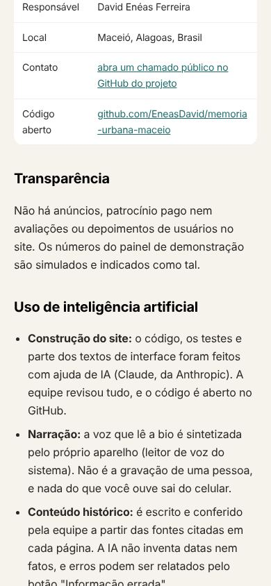 |
| [KAN-171](https://ic-team-yrsngn10.atlassian.net/browse/KAN-171) | Links internos "Perto daqui" | 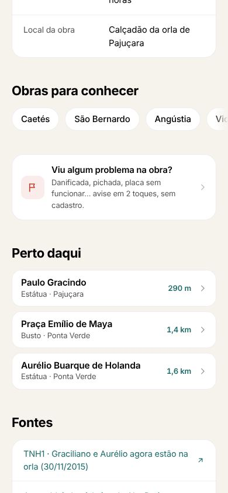 |
| [KAN-172](https://ic-team-yrsngn10.atlassian.net/browse/KAN-172) | Imagem de compartilhamento (OG) | 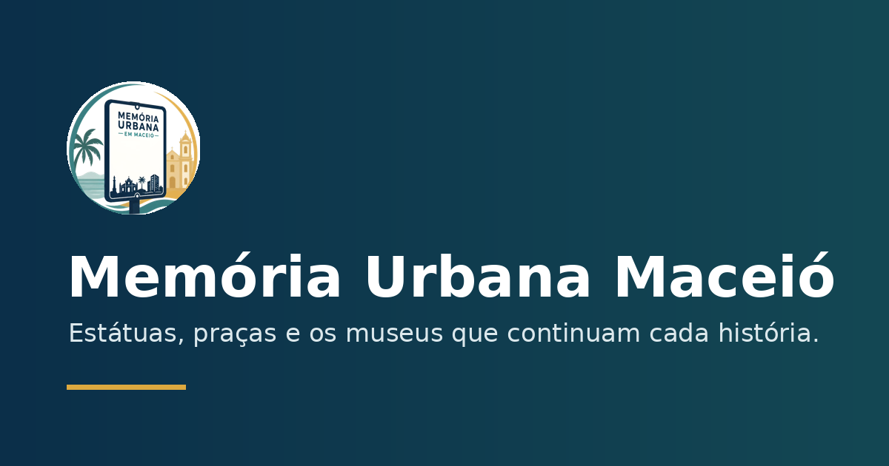 |
| [KAN-184](https://ic-team-yrsngn10.atlassian.net/browse/KAN-184) | Área logada igual ao Figma | 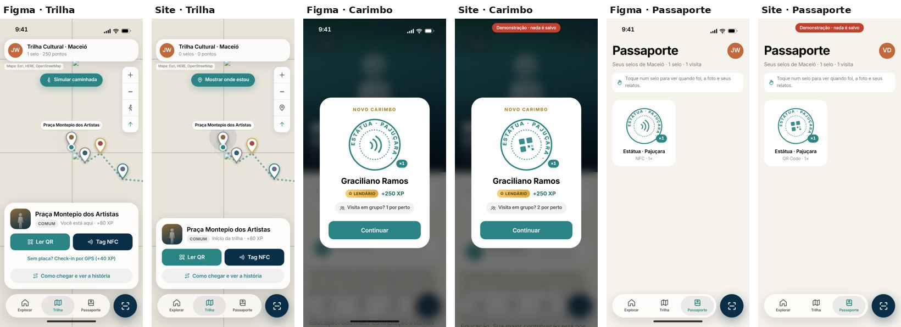 |
| [KAN-185](https://ic-team-yrsngn10.atlassian.net/browse/KAN-185) | Área logada sem simulações | 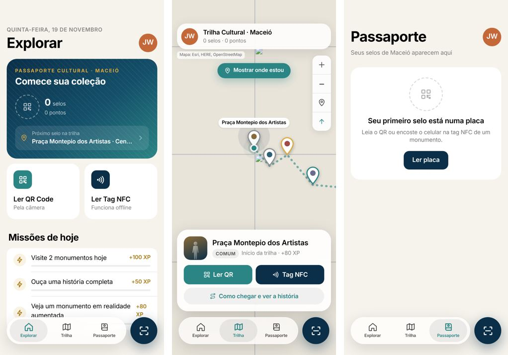 |
| [KAN-186](https://ic-team-yrsngn10.atlassian.net/browse/KAN-186) | Aviso antes da câmera do leitor | 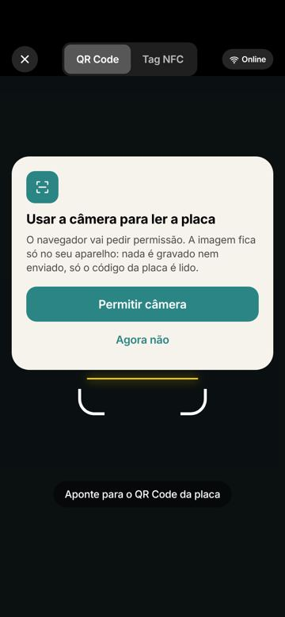 |
| [KAN-190](https://ic-team-yrsngn10.atlassian.net/browse/KAN-190) | Identidade com os detalhes da logo | 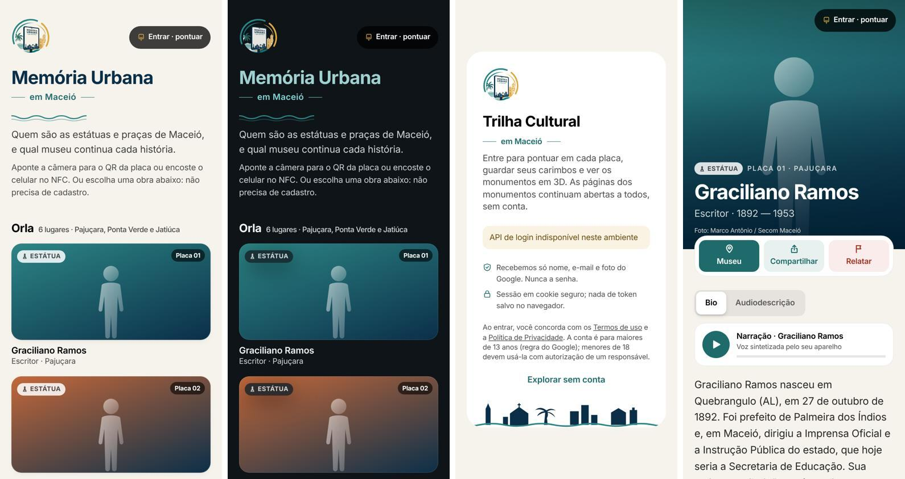 |
| [KAN-191](https://ic-team-yrsngn10.atlassian.net/browse/KAN-191) | Estrela trocada por placa e estátua | 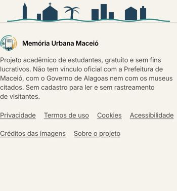 |
| [KAN-193](https://ic-team-yrsngn10.atlassian.net/browse/KAN-193) | Identidade da logo no painel do gestor | 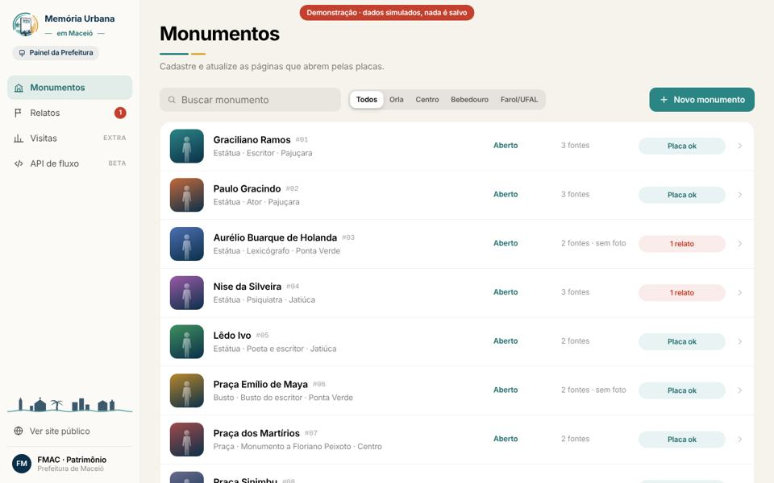 |
| [KAN-194](https://ic-team-yrsngn10.atlassian.net/browse/KAN-194) | Localização real na Trilha | 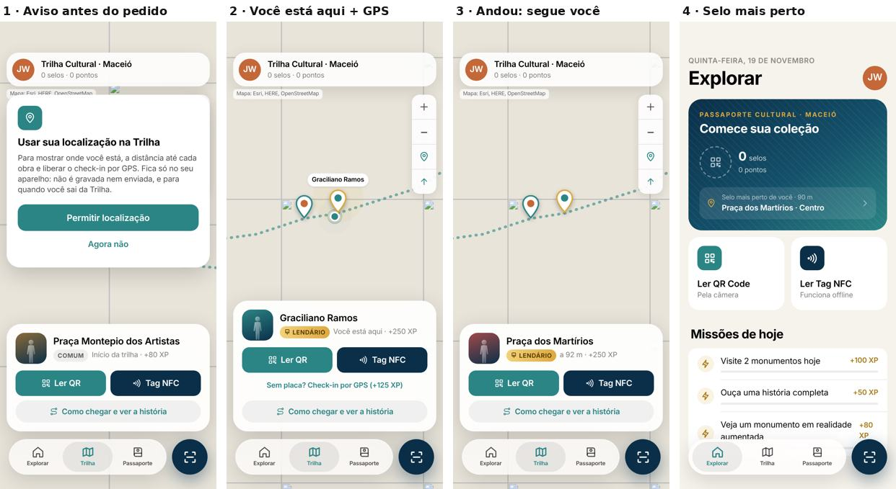 |
| [KAN-195](https://ic-team-yrsngn10.atlassian.net/browse/KAN-195) | Identidade da logo na área do visitante | 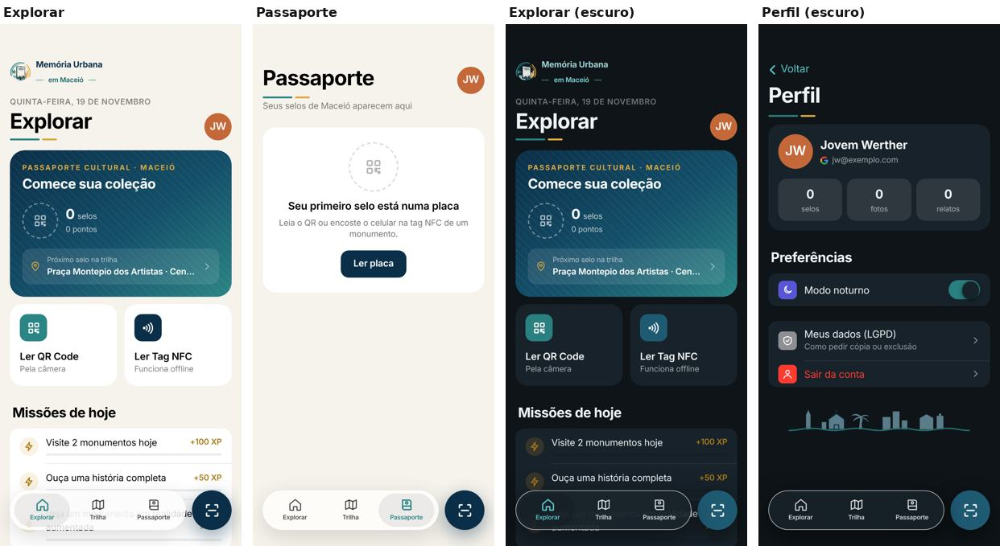 |
| [KAN-196](https://ic-team-yrsngn10.atlassian.net/browse/KAN-196) | Lista de monumentos na área logada | 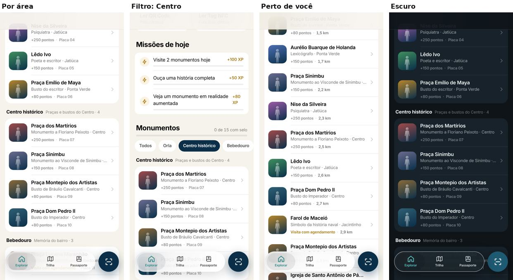 |
